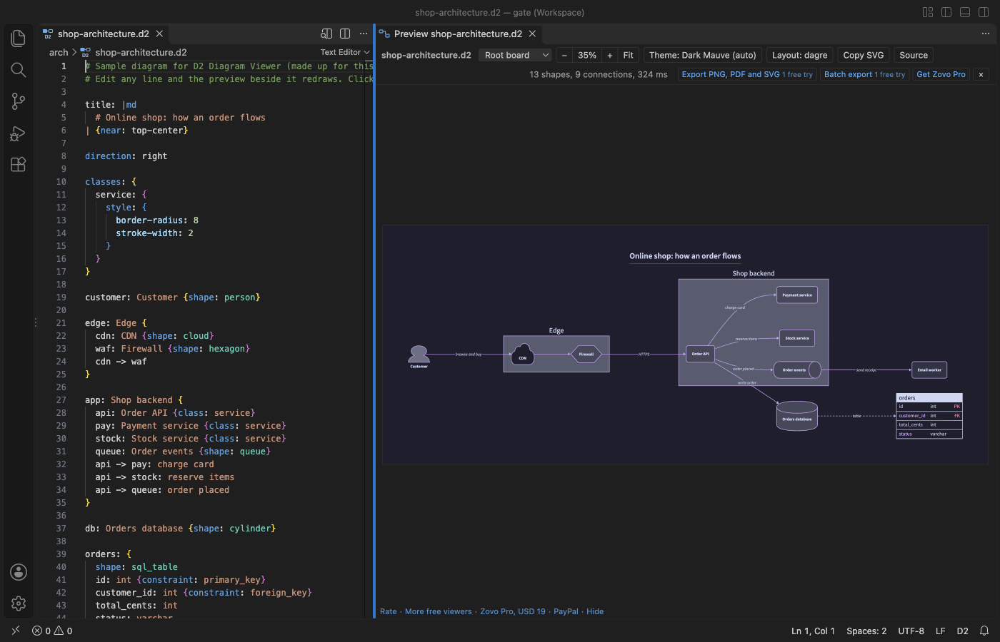

# D2 Diagram Viewer & D2 Preview

Write D2 diagrams in VS Code and see them drawn beside the text as you type. The D2 engine is built in, so there is nothing else to install. Works offline. Made by Zovo.

Free, with no account and no network calls:

- A live D2 preview next to the editor. It draws again a moment after you stop typing, and it keeps your zoom and position while you edit.
- Pan with the mouse, zoom with the wheel or the + and - buttons, Fit to see the whole diagram, 100% for actual size.
- The preview follows VS Code: a dark VS Code theme gets a dark D2 theme, a light one a light D2 theme, unless the .d2 file sets its own.
- Pick any of the 20 D2 themes for one preview, change the layout direction or turn on the sketch style. Only the preview changes: the extension never touches your VS Code theme or your settings.
- Errors show as red squiggles in the editor with the line number, in the Problems view and at the top of the preview, where a click jumps to the line. The last good drawing stays in place until the text is fixed.
- Click a shape in the diagram and the editor jumps to the line where it is written.
- Diagrams with layers, scenarios or steps get a board list in the preview toolbar.
- Copy the diagram as SVG text with one click.
- Imports (`x: @lib/part`, `...@base`) are read from the workspace folder, unsaved changes included. Pictures next to the .d2 file show in the diagram.
- Syntax highlighting with a grammar written for this extension.

Open a `.d2` file and click the preview button at the top right of the editor, or run D2: Open D2 Preview to the Side from the Command Palette. The diagram can also open in place of the text with Reopen Editor With... > D2 Diagram Viewer. Nothing opens by itself.

Zovo Pro: USD 19 once, for the Pro tools in every Zovo extension. Each Pro tool has 1 free try on your computer first:

- Export PNG, PDF and SVG: the diagram as PNG at 1x to 4x, as a PDF, or as SVG, with the padding and D2 theme you choose. For a diagram with layers, scenarios or steps, export the board on screen or every board: separate PNG or SVG files, one PDF page per board, or one animated SVG that steps through the boards.
- Batch export: render every .d2 file of a folder to SVG in `docs/diagrams` (or a folder you choose) in one run, keeping the folder structure. Files with errors are listed with their line. Watch mode renders a file again when it changes on disk, until you click the watch item in the status bar.

The Pro tools are in the Command Palette (D2: ... (Pro)), in the editor title menu, in the right-click menu of a .d2 file or folder, and in the small row at the top of the preview. The row closes with its x for the rest of the session, and the setting `zovoD2.showProTools` hides it for good.

Made by Zovo.

## Details

- The diagram is drawn by the official D2 engine (version 0.7.0) compiled to WebAssembly and shipped inside the extension. It runs in VS Code itself: no D2 program is installed or started, and no file leaves your computer.
- Layout: the bundled engine has the dagre layout. A file that asks for another layout engine in its `d2-config` is drawn with dagre, and the preview says so.
- Pictures from the web (`icon: https://...`) are not loaded, because the viewer makes no network requests. The preview counts them in a note. Pictures in the workspace folder are shown.
- PNG and PDF exports are pictures of the diagram. PDF pages have the size of the diagram.
- Files larger than 2 MB show a message instead of a drawing (setting `zovoD2.maxFileKB`). A layout that takes longer than 20 seconds stops (setting `zovoD2.renderTimeoutSeconds`).

## Settings

| Setting | Default | What it does |
|---|---|---|
| `zovoD2.preview.updateDelayMs` | `300` | Wait this long after typing before the preview draws again |
| `zovoD2.preview.lightTheme` | `0` (Neutral Default) | D2 theme of the preview with a light VS Code theme |
| `zovoD2.preview.darkTheme` | `200` (Dark Mauve) | D2 theme of the preview with a dark VS Code theme |
| `zovoD2.renderTimeoutSeconds` | `20` | Stop a layout that takes longer than this |
| `zovoD2.maxFileKB` | `2048` | Larger files show a message instead of a drawing |
| `zovoD2.export.scale` | `2` | First scale offered by the Pro export |
| `zovoD2.export.padding` | `100` | Space around exported diagrams, in pixels |
| `zovoD2.export.animateIntervalMs` | `1500` | Time per board in an animated SVG |
| `zovoD2.batch.outputFolder` | `docs/diagrams` | Output folder of the batch export |
| `zovoD2.batch.theme` | `0` (Neutral Default) | D2 theme of batch exports |
| `zovoD2.showProTools` | `true` | Show the Zovo Pro tools |
| `zovoD2.askForRating` | `true` | Ask once for a rating, later on |
| `zovoD2.showSupportLinks` | `true` | Small Rate, More free tools and Zovo Pro links under the preview |

## Privacy

The extension reads the .d2 files you open, the files they import and pictures next to them. Pro exports write only the files you ask for. It makes no network requests of its own.

## License

MIT. The bundled D2 engine is MPL-2.0 and ships unchanged as a separate file: see THIRD-PARTY-NOTICES.md.
